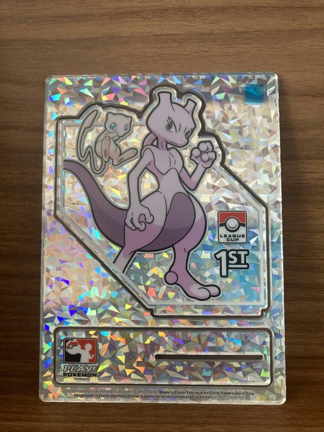

Published on November 13th, 2026

# Solving Galactic Puzzle Hunt (2026)

This post contains unmarked spoilers for Galactic Puzzlehunt 2026.

Despite my strong hatred of coffee, as known by my friends over from the Eventual Comeback of /r/PictureGame, I was very excited for another GPH in the horizon and the opportunity to hunt with my friends. Here are some puzzles I have things to talk about or an interesting experience of ours to highlight:

### [6 7](https://2026.galacticpuzzlehunt.com/puzzle/6-7)

Surprisingly polished and interesting idea with a very funny presentation, i would've given it a 10/10 but I think a 6/7 is more apt!

### [Make Your Own Cheryl's Birthday](https://2026.galacticpuzzlehunt.com/puzzle/make-your-own-cheryls-birthday)

It's always cool to see what Galactic cooks up with their "Make Your Own" series of puzzles, I thought this was a very interesting puzzle, I was able to work on it enough to get some letters, but many times I had thoughts like "ok, there has to be some gimmick here because what I'm doing should extract this cell but it isn't" and everytime I was doing some silly mistake, oops!

### [Stacked](https://2026.galacticpuzzlehunt.com/puzzle/stacked)

I've recently finished my ECPH2 postsolve, so <a href="https://2024.ecph.site/puzzle/duality">Duality</a> was very fresh in my mind. Given the rest of the group I was writing with also comprised many ECPH2 writers, this was basically an aha-less puzzle for us, but it was still quite cool! Especially because as far as I understand this 3-cuboid net was a recent mathematical breakthrough, so this puzzle couldn't've been written in late 2024, or well, at least not without a mathematical breakthrough of its own during the writing phase.

### [Wordtris](https://2026.galacticpuzzlehunt.com/puzzle/wordtris)

I thought the Wordle puzzle fad was over, but I'm glad to see it wasn't because this was a really fresh take on it! The final extraction was very neat and satisfying.

### [[•][→↘&#xFE0E;][↑↑][↙][←↖&#xFE0E;][↑↖&#xFE0E;] [↓↓][↖&#xFE0E;][←][↑↗][↑][→→][↓↙][↓↙][←↙][↓↘&#xFE0E;]](https://2026.galacticpuzzlehunt.com/puzzle/arrows)

This was solved while I was asleep but it's such a cool idea! I'm really disappointed the title isn't Unicode characters but I tried my best here anyway. Also I don't believe the author's notes that the construction isn't as constrained as I think, I'm pretty sure it's exactly as constrained as I think it is!

### [Duality II](https://2026.galacticpuzzlehunt.com/puzzle/duality-ii)

"Duality II? I thought that was Stacked" was the joke our whole team wanted to make upon unlocking this, but in all seriousness this was very cool and such an elegant construction in so many different ways. Unfortunately it was also solved while I was asleep!

  

Maybe I'd enjoy puzzlehunts more without having to do this "sleep" thing hmm...

### [Realism](https://2026.galacticpuzzlehunt.com/puzzle/realism)

I think this was my favorite puzzle in the hunt. It's such a natural idea to extend to logic puzzles, and genuinely I thought Skyscrapers worked kinda like this the first time I tried solving, but only along the axis the number clue was pointing at, not extending three-dimensionally. Our team divided into groups to solve each logic puzzle and I took the Pentopia that was left but I found it incredibly fun, maybe when I have some spare time I should go back and try the other ones. Unfortunately we couldn't solve the meta Skyscraper with all givens and ended up backsolving this, tragic!

### [🔠](https://2026.galacticpuzzlehunt.com/puzzle/abcd)

I contributed stellar classification and international vehicle codes, if my memory serves me right, very cute idea!

### [Connect The Dots](https://2026.galacticpuzzlehunt.com/puzzle/connect-the-dots)

As someone with a slight special interest in constellations, it was very cool to unlock this, some teammates beat me to identifying most of the constellations before I got the chance to open the puzzle, from there I helped with the rest and started looking at the grid in the bottom. I was very confident we had to place the constellations in the grid, but after a long time of trying, I finally got one to work. Then I kept trying again and getting increasingly closer to give up and say "Ok the fact that the previous one worked must've been a coincidence and this isn't actually right" but then I'd eventually find where it lined up, this process repeated itself like two or three times. I don't know why it was so much harder than I was expecting to place these, maybe just skill issue. It was getting late so I handed the puzzle over after three or four constellations and went to bed. Woke up to find a very clever semaphore extraction that makes sense but that I'd have had no chance getting on my own. I remain curious why Lyra was never actually used for extraction though.

### [Oops!](https://2026.galacticpuzzlehunt.com/puzzle/oops)

Shoutouts to very cool puzzles that your team solves while you were asleep, gotta be one of my favorite genders!

### [Figuration](https://2026.galacticpuzzlehunt.com/puzzle/figuration)

Speaking of gender, I was also getting very cisn't vibes from Dawn, I just elected to not say anything, and it looks like so did the whole rest of my team until we unlocked this puzzle, at which point we basically spoke our minds in unison about how she was trans, so that of the aha was quite gettable for us! We did red herring ourselves a lot by thinking of the trans flag as a grid, and not an ordering of indices, though, oops! We ended up having to hint this, but this is just an apt allegory of the process of having to ask your friends for help in the arduous process of uncovering your gender, or something!

### [Menu Update](https://2026.galacticpuzzlehunt.com/puzzle/menu-update)

We vibed "Dubai Chocolate" correctly here without having the answer but struggled a bit more with the others, we were between matcha and bubble tea and weren't super sure on the milk. Eventually we did get <code>CHOCOLATE COINS</code> as an answer and that let us figure out <code>CHOCOLATE DIRHAMS</code>, we were struggling to get the other ones despite having the answers, though, but I was able to vibe the correct answer from our partial WOF, it's always a great feeling when you can do that!

### [Birth Charts](https://2026.galacticpuzzlehunt.com/puzzle/birth-charts)

I don't know how many people know this, but due to the <a href="https://en.wikipedia.org/wiki/Axial_precession">axial precession</a> of the Earth, the constellations that all celestial bodies appear in from Earth, are slightly offset than they were in the olden days when the zodiac was invented. So that means that when you say "Venus is in Aries", if you physically look up at the sky, you might see Venus is actually in Taurus from our perspective here on earth instead. And naturally with Lam being such a scientifically-minded and skeptic person, she would misunderstand Camille and for her we actually have to check where the actual planets were according to the IAU constellation borders, it makes perfect sense, right? Nevermind these weird symbols in the puzzle that I have no idea what they are though. Except it wasn't it, of course, after <i>a lot</i> of scattered attempts by me to make this work, we ended up having to ask a hint and learned that you can look at people's astrological signs together, I didn't know that was a thing and apparently neither did any of us, but the hint got us unstuck. Very cool meta but I can't help but wish the version I hallucinated was the one actually used, hahaha '^^

### [Goodbye](https://2026.galacticpuzzlehunt.com/puzzle/goodbye)

I was about to leave for a VGC (competitive Pokémon) local tournament when we unlocked this, but seeing what the capstone actually was, I feel like it wouldn't've played much to my strengths at all, this is exactly the kind of thing I am horrible at, reading a lot of text and like interpreting things, and piecing them together, just not my forte. Thankfully my teammates persevered, and so did I:
 

 

All in all, this was a fantastic hunt. Our team was very stacked so we were among the first few teams to finish which was a very new experience to me! I don't think this hunt had quite the impact Galactic Puzzle Hunt 2025 had for me, due to the fact I was coming out of a puzzlehunt burnout then and it was exactly what I needed at that time to reignite my passion wholeheartedly. Still, this hunt came at a great time (any GPH anytime is extremely welcome) and it was such a blast reuniting with my EC friends for a solve!

Speaking of friends, all the characters in this hunt were written so impeccably, I was surprised reading from the wrap-up with how little time advance all the dialogue was fleshed out, because they all seemed so well-written and genuine. I think it's a good sign how well this hunt's story and characters were done that I genuinely felt like I wanted to hang out with them after it was done.

Thanks for the hunt as always Galactic, I am a huge fan of y'all's puzzles and I'm looking forward to next time's reunion!
