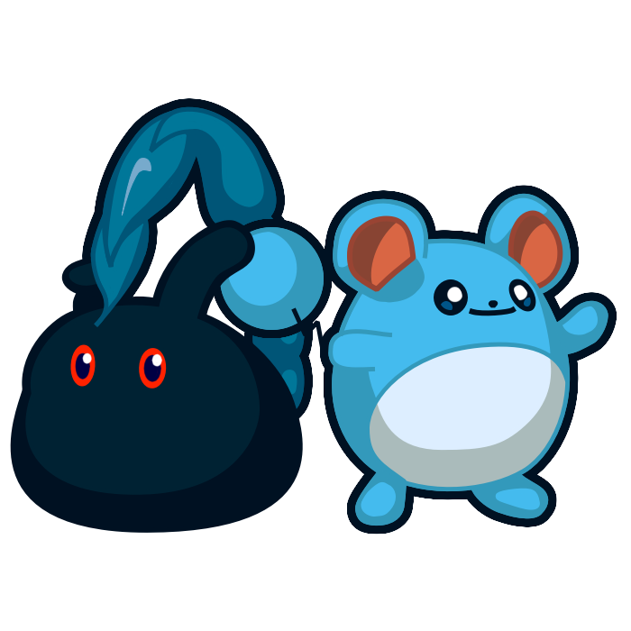
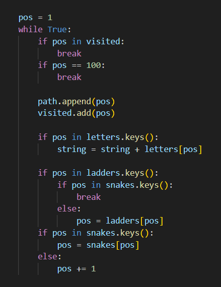
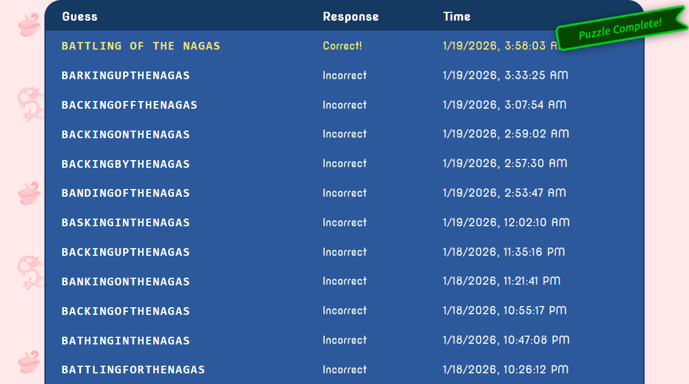
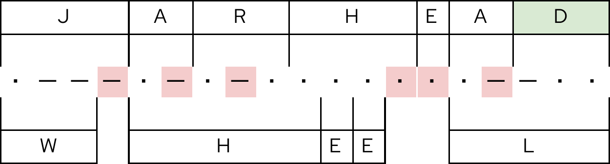
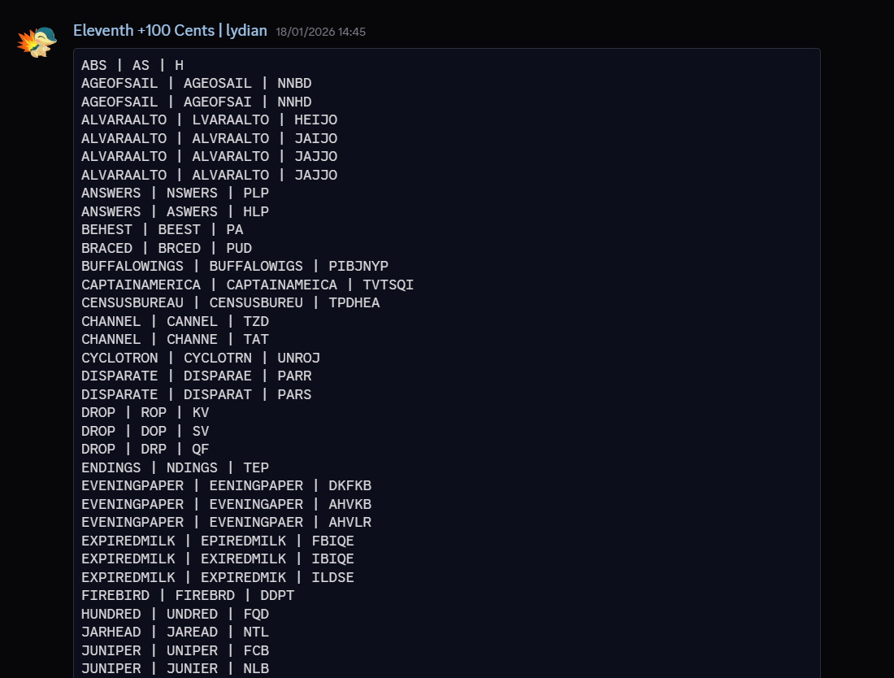

Published on January 30th, 2026

# Solving MIT Mystery Hunt (2026)

This post contains unmarked spoilers for MIT Mystery Hunt 2026.

Everyone knows the MIT Mystery Hunt is the final boss of puzzlehunts, and just like any good final boss, the most important part to get the ambience right is a good theme (seriously, listen to Tabuu, Cynthia or Marx's battle themes). And while I personally couldn't think of a theme that would appeal more to me than 2020's Penny Park, as a huge enthusiast of roller coasters and theme parks, I did overlook one possibility: turns out there was only one theme that I could do it for me, and Cardinality chose just the one! When we first got the cryptids theme from The Providence Bureau of Invest-Egg-Ations's Mystery Hatch — which, by the way, was a brilliant hunt! I just didn't make a post because I felt like I didn't have much to say —  I saw many theories circulating about a potential Pokémon-inspired theme for the full hunt, but I decided to keep my hopes low because you never really know with Mystery Hunt themes. But when the fated day came and the Kick-Off made it very clear that Puzzmon were inspired by a certain other monster collecting franchise I'm obsessed with, I was already jumping with joy! Of course, on top of the joy of the theme reveal, the Kick-Off also comes with the joy of "holy shit puzzles will be out in less than an hour"!

Not to get ahead of myself though, I should probably mention that this year I joined the Exotic Creatures of r/PictureGame to hunt, and it was a blast hunting with them! The relatively smaller nature of the team make me feel like I got to see a lot more of the hunt than I got to in prior years on larger teams, although I will also attribute that to my solving skills improving since the last Mystery Hunt I did, and getting to know everyone and hang out before hunt made solving together all the more seamless and fun! I'm looking forward to one day have the chance to participate in Mystery Hunt in person, but the weakness of our currency, earning very little for undergrad research scholarships, and being honestly a bit scared of what the US is doing to people that look like me made hunting in-person this year an impossibility. But I'm hopeful one day the day will come that I can go and meet all of my online friends in-person!

Another thing that I do think I should point out though, is that I ended up having a bit of a cold right during Mystery Hunt weekend, to which you might say "but don't you live in Brazil? Isn't it like 35 °C over there?" to which I'll answer "Yes but I traveled for my summer break and I must've caught it in the airplane on the way back '^^". Thankfully it didn't impact things too much, but I did end up being a bit more scatterbrained than usual and having to sleep like 10 hours to feel more rested instead of my usual 8, which I know, that's a lot of sleep, but I've always needed a lot not to wake up a zombie the next day, so I did really prioritize sleeping, especially with my cold, which I think was the right move, but it did take away more Mystery Hunting hours than I was expecting!

That all aside, let's talk about some puzzles I wanna shout out or that we've had interesting experiences on:

## [Aviaria](https://puzzmon.world/rounds/aviaria)

Aviaria was the first round of the hunt, and I was already a bit surprised to see a deviation from a common puzzlehunt standard, the capstone puzzles here did not use feeders as answers, but rather Puzzmon data. On top of the MonQuest and the unique unlocking system chosen here, it was a lot to take in!

<h3><a href="https://puzzmon.world/puzzles/replacements">Replacements</a></h3>

This was the first puzzle I started working on, with phenomist and Sam. I worked on one or two of the Ken Ken and then drifted off leaving one of them with the final step which wasn't parallelizeable. But I still wanted to mention this because I thought it was such an elegant execution! The Ken Ken on the Tech being constructed with two alternate solutions, and the final extraction of `BRACED` playing perfectly with the gimmick of the puzzle, just felt absurdly satisfying, and set a very good first impression for the hunt to come!

<h3><a href="https://puzzmon.world/puzzles/bird_nation">Bird Nation</a></h3>

Of course being on the team of geography fiends that is EC, it didn't take long for quatrevingtneuf to go "hey these kinda look like country flags" and we solved it pretty quickly! I think it was a really elegant introduction to capstones to show us how we can use the Puzzmon data to solve these kinds of puzzles. Of course, I did suspect these answers would be used at a later point, because surely <code>NFL FANS</code> had to feed into something! But it would be a while until I'd find that out!

## [Bubble Cove](https://puzzmon.world/rounds/bubble_cove)

It didn't take long for us to unlock a new round, before solving the Bird Nation capstone, but I decided to organize my post by round instead of chronologically, as I think things end up more organized this way! This was the round that I most interacted with MonQuest, and I tried to Find Burnham's Marbles, until I realized that the fishes' hitboxes were way more unforgiving than I was expecting and someone would probably outgamer me on that one. And it was solved by someone else immediately after I gave up, so yeah, my theory was right!

<h3><a href="https://puzzmon.world/puzzles/crossloop">Crossloop</a></h3>

I wanted to talk about this puzzle because while it's not absurdly groundbreaking, it is such a neat idea and it's executed so well! The concept of combining a Simple Loop with a Crossword seems so obvious in hindsight (and maybe it's been done before, but this is the first time I see it, at least) that it just felt nice to solve. This is the kind of puzzle that I'll take away from this hunt as being a great example of a beginner-friendly puzzle to introduce people to the hobby with! Also I will say, I kept breaking the Simple Loop when trying to solve it, until someone else probably got fed up with my slowness, or more likely didn't know I was already working on it (which like, it shouldn't take more than 30 seconds tops anyway, so fair!) and solved it first, and only after we were done with the puzzle, I realized I had mistranscribed one pair of rotationally symmetric squares of the grid into puzzlink, woops!

<h3><a href="https://puzzmon.world/puzzles/bringing_up_baby_shark">Bringing Up Baby Shark</a></h3>

Our team noticed the types of shark inspirations on the fish very quickly, but it took us a little bit more to see the shark phrases being suggested by the descriptions. I pointed out very early on that these descriptions were probably useful for this capstone as they weren't "red herring" descriptions but just "herring" this time, but still we kinda didn't really see the shark phrases for a few minutes and thought the descriptions were just cluing the types of sharks as well. In the meantime before we got the "shark phrases" aha though, I was googling frenetically about Baby Shark and trying to look if there were any variants of it out there with the clued sharks or something of that nature, but thankfully that wasn't actually how the puzzle worked...

## [Old Bark Town](https://puzzmon.world/rounds/old_bark_town)

Immediately when we unlocked this round (alongside Kitty City, cute!) I had that "neuron activation" meme thing going on about New Bark Town being a town in Pokémon, so definitely this round's capstone will involve Pokémon, right, right?

<h3><a href="https://puzzmon.world/puzzles/balancing_act">Balancing Act</a></h3>

This is a puzzle we began working on, but kinda slowed down a bit on, given the path of least resistance was elsewhere, and came back to it later on Saturday when the path of least resistance snaked its way back here again. I enjoyed working on the clues and figuring out exactly how to piece together a part of the puzzle as soon as I saw "Roman, e.g." upon opening the puzzle! The actual connection that the letters of the answer matched the number of words in the clue and that that's how extraction worked I wasn't around for, but reading back on the solution I'm just really fascinated by the puzzle! It's such an elegant way to realize the idea! And it makes me appreciate it much more than when I first saw the diagram at the bottom and thought that was the extraction!

<h3><a href="https://puzzmon.world/puzzles/central_precinct_and_lockup">Central Precinct & Lookup</a></h3>

As an enjoyer of cryptics despite being horrendously bad at them, I did try to stare at this puzzle for a bit, but then thought my efforts were probably best spent elsewhere (by which I mean staring elsewhere, not necessarily solving elsewhere). That said, I do still want to shout out this puzzle here, because the construction seems so unbelievably tight to make the center work. And the mechanics of extra letters and extra words just working together to make the final step happen is just really awesome! Even if most of this puzzle I didn't experience first-hand, it's still one of the most impressive on the hunt for me!

<h3><a href="https://puzzmon.world/puzzles/three_dog_night">Three Dog Night</a></h3>

Me upon seeing this puzzle's title: "Oh my theory was right, three is the number of starter Pokémon that you can choose in New Bark Town, this is totally a Pokémon capstone!" (It was not a Pokémon capstone.) When I actually opened the puzzle and our sheet on it, my teammates had already identified the Blues' Clues and Bluey connections. And we were for the longest time trying to figure out who the third dog was. Paw Patrol was suggested at some point, and it seemed promising that characters had associated numbers, but things just didn't fit. After a long time, some brought up Huckleberry Hound and we managed to get the puzzle solved. I don't feel particularly bad for not being the one to have that aha because I did not know this guy's name in Portuguese, let alone English. I do appreciate though how this puzzle features three different blue dogs from three very different generations (it definitely reminded me how much I used to watch Blue's Clues as a kid!), I think that's kinda neat even if the three-part approach to the puzzle didn't feel as cohesive to me mechanically.

## [Kitty City](https://puzzmon.world/rounds/kitty_city)

<h3><a href="https://puzzmon.world/puzzles/night_circus">Night Circus</a></h3>

I feel really bad for not being able to progress much on this puzzle during hunt. When we opened this puzzle someone had left a note in the Sheet theorizing that each line represented one planet, and that made sense with the theming, and the fact that there were eight of them. The Pokémon fan that I am I got ♂ for Mars immediately, and someone got Saturn shortly after. So everything so far seemed to indicate that these were the 8 planets, but we struggled to get the other symbols to fit... I went to bed and it was solved the next day, but as someone with a special interest in minor planets I was deeply disappointed to find out that I didn't even consider them, when I knew they had unique symbols as well! Alas! I can't really blame the puzzle, I really like it, in fact, but my understanding is that there's no reason why there are exactly 8 examples, and I think choosing a different number would've helped us avoid a red herring at least! Also, since Toutatis has appeared on this puzzle, I need to shout out another one of my special interests and say that it looks like <a href="https://rcdb.com/16327.htm">a really fun roller coaster</a>, and I need to visit Parc Astérix immediately.

<h3><a href="https://puzzmon.world/puzzles/watchtower">Watchtower</a></h3>

Right after Kickoff we got these very puzzle-shaped nametags, so we began solving even before the hunt would start at 13:05 TIMEMIT. Someone originally proposed <code>D.* H.*</code> initials for <code>DUGONG HUG</code>, <code>DOCTOR HAMMER</code>, <code>DRINK HEAVEN</code>, etc, but eventually we realized that <code>M.* H.*</code> and, later, <code>M.{6} H.{5}</code> made a lot more sense! Unfortunately we had no clue how to extract because we didn't notice the stars changed position, so this ended up being our first hint, oops!

<h3><a href="https://puzzmon.world/puzzles/nine_lives">Nine Lives</a></h3>

This capstone actually took us a while, we only solved it on Sunday. I don't know exactly how my teammates interpreted the puzzle, i,e, if they fell into the same rabbit hole I did, but me personally I thought the patterns on the cats were the responses they'd give to all other 18 questions from the other cats, not the responses given to their own questions, and thus, that there would be some way to order the cats to be able to figure out the answers to their twenty questions. So for instance, the first two "'yes' or 'no'"s on the pattern of the first cat, would correspond to the second cat's questions, the third and fourth "'yes' or 'no'"s to the third cat's, and so on... This led us trying to associate the cats from their drawings and names for things with dates that we could order, e.g. when the first episode of Garfield came out... Which obviously didn't really work... Eventually the puzzle got solved while I was asleep. It's always a bit frustrating to find out that a puzzle you were stuck on was leagues more intuitive and logical than whatever kind of mental gymnastics you were doing to try to make it work, hahah! But the puzzle is great, this is one of the many cases where I take full responsibility for being stupid! Although it is just a bit funny that the mathematical coincidence of 9 lives and 20 questions divided in two sets of 2 results in the other possible interpretation I had adding up. The solution to not have that problem while keeping the 9 lives and the 20 questions would have been to have 20 puzzmon instead of 10, each with one question instead of two, but I don't think anyone would've liked that option!

## [Elder Drifts](https://puzzmon.world/rounds/elder_drifts)

<h3><a href="https://puzzmon.world/puzzles/shapes">Shapes</a></h3>

This puzzle, and most of Elder Drifts, for that matter, was solved while I was asleep, but I need to shout it out because it's actually <i>so</i> funny and such a brilliant idea. The mechanical connection between the puzzle and the TikTok it's referencing legit never fails to make me laugh!

## [The Brights](https://puzzmon.world/rounds/the_brights)

<h3><a href="https://puzzmon.world/puzzles/lights_down_mode">Lights Down Mode</a></h3>

I was awake while this was getting solved, but I spent most of my awake hours on Saturday solving another puzzle I'll talk about eventually, so I missed this capstone, still wanna talk about it though... Darkrari is a really fun genre, and an even better name. I've always thought the concept of puzzles that display differently for different people is a rather underexplored concept, so it was cool to see it used in a capstone in such a thematic way, even!

## [Royal Groves](https://puzzmon.world/rounds/royal_groves)

<h3><a href="https://puzzmon.world/puzzles/rock_on">Rock On</a></h3>

I saw a teammate working on this puzzle send an image they'd gotten from one of those browser spectrogram sites on our voice chat's text chat asking for if we saw anything on a very fuzzy image (I didn't see anything, at least), so I offered to use FL Studio to get better images of what was going on and we were able to read the extract from the puzzle! It's a pretty standard fair ISIS puzzle and I like the thematic link to the Green Building, but I just wanted to use this as an excuse to say I like puzzles where I get to open my DAW for!

<h3><a href="https://puzzmon.world/puzzles/filial_pie_tree">Filial Pie Tree</a></h3>

This puzzle got solved while I was asleep from Saturday to Sunday, but I need to talk about it, using Puzzmon evolution and category made me really appreciate the mechanical and thematic tie-in to Pokémon more than other rounds, and the connection to Pokémon that have numbers in other languages did not go unnoticed (e.g. Articuno, Zapdos and Moltres; Deino, Zweilous, Hydreigon; as also indicated by the Author's Notes)! It's just a really cute puzzle, I'm a fan!

## [Eland Islands](https://puzzmon.world/rounds/eland_islands)

<h3><a href="https://puzzmon.world/puzzles/keep_going">Keep Going!</a></h3>

Also didn't solve this one, but I wanted to talk about it, I like the concept of the puzzle a lot, being given incremental steps to figure out a ciphered alphabet is a lot more interesting than it originally seems from just this description, but the main reason I wanted to talk about it is that I'm glad that the authors didn't decide it was a problem from the answer to be kinda guessable. I think obviously this is a bit bad on metas, especially ones that unlock early as used to be tradition for Mystery Hunt, obviously bypassing a whole round is cool for the split moment you do it, but be honest, are you really going back to postsolve it after hunt and managing to organize your at least 30+ person MITMH team to go alongside you? In that sense it can be a bit of a feel-bad for the team bypassing the round too. And in another way, bypassing a meta or capstone of any kind can be a bit of a bummer since they can be the most significant puzzles in a hunt, and them feeling challenging and rewarding is really important for the feel of the hunt, at least to me. But on a feeder, I actually think it's fun to open that door to the answer being guessable, as far as I know our team wasn't one of the ones that cheesed it, but I think it's gotta be such a fun feeling to just have that happen to you, that I'm glad it was kept as is, and ultimately having one feeder have a bit of a chance to be bypassed isn't enough of a dent on the competitive integrity of the hunt enough (or at all) to outweigh the thrill that the few teams that got to bypass it would have, in my opinion!

## [Serpentine Hills](https://puzzmon.world/rounds/serpentine_hills)

<h3><a href="https://puzzmon.world/puzzles/australian_caduceus">Australian Caduceus</a></h3>

It's sunday, the coin has been found, this is the final capstone we need to solve to be able to have the midhunt runaround before HQ closes. While some progress has been done, we're ultimately kind of missing more feeder solves to get there, and the logic of where to place the ladders hasn't been figured out, so I hop in and decide to code something. Before that though, phenomist had used a solver to generate all possible orientations on how to fill the rectangles on the square grid, so I used that output to go through every possibility given the snake positions that we knew, and see which ones worked. In the meantime that we were solving, someone logicking it out manually landed on a configuration which matched the exact one my code was outputting! So far so good, but there was a small problem, while other people working on the puzzle knew that one of the snakes's position wasn't fixed, broken telephone and potentially subpar notation on our sheet and Discord meant that I erroneously thought the snake positions were finalized, which they weren't. There are good news and bad news about this. The good news is that, thankfully, the snake position that I assumed we were certain of, ended up actually being the one that was correct for the puzzle by sheer coincidence! The bad news is that, unfortunately, I made a mistake on my code, see if you can spot it:
 

 

The mistake here is that this if should've been an elif, as is this means that whenever the code goes up a ladder, it also advances one extra square. And this means that instead of extracting <code>BA???ING??THENAGAS</code> like it should've, it was extracting <code>BA??ING??THENAGAS</code> instead, which was also a valid extract if the code were correct and Ttattell were in a different position, as would be <code>BA????ING??THENAGAS</code>. But of course, I didn't know any of this at the time, so I just assumed it was always <code>BA??ING??THENAGAS</code>, and I don't think anyone was around to tell me that that wasn't always true, so we kept trying to WoF until we got rate limited and kept guessing as much as the puzzle would let us, until it was too late to do the midhunt runaround anyway, at which point I went to bed and the puzzle was solved overnight with actually correct information, and an extra feeder:
 

(aside from BATTLING FOR THE NAGAS which I also included here, we had a bunch of guesses before we got to BA.{2,4}ING..THENAGAS)
 

It's especially funny to me that we had <code>BATTLING FOR THE NAGAS</code> before I did my thing and assumed that the number of blanks between "ING" and "THE NAGAS" was always 2... Yikes! I think this situation ended up being frustrating for some as our WoFing abilities plus a bit of miscommunication maybe were clearly not enough, and this meant missing the midhunt runaround, and I certainly am disappointed in the bug of my code that I only realized after the hunt was over, but still I find this situation a thousand times more funny than frustrating, the thrill of waiting 15 minutes with the whole chat trying to come up with increasingly worse puns as our better ones kept getting rejected, the extreme confidence in everyone going "this has to be it, there's no way!" every time and then it not, in fact, it! I don't know, these kinds of moments are some of the most memorable in puzzlehunts for me!

## [Kingdom of the Puzzmon](https://puzzmon.world/)

We only got the metas here on Sunday, we had them unlocked for a while, but I don't think people really touched them until we had all of them, by that point hints became available on these right was we had knocked down a few, and we were kinda worried we wouldn't finish (we didn't! but it was pretty close I think) so we just spammed hints on these when we were stuck! "Procrastinating" the round all for Sunday did mean that I got to watch all of these falling in a row and even contribute to most of them, which felt really really nice! Metas are always special to me, and I think for most puzzlers, because they really embody, at least to me, what differentiates a puzzlehunt from other kinds of puzzles and what makes this type of event so special to me, the concept of all your answers, and by proxy, your work coming together to advance the hunt more globally, it's fun! So solving a meta is always a thrill, and getting to do a boss rush of metas, even more so.

In general though, needless to say that this round was very fun! The final meta-matching extravaganza was a brilliant way to finish off the Kingdom, but I will say I think the general theme of the metas ended up feeling a bit incohesive? disconnected? I don't know if that makes much sense, but unlike the Kingdom capstones and the Dimension metas that all felt pretty aligned with their Rounds' concepts, since these didn't really have them, they didn't really feel particularly tied to the hunt's concept. Like, they felt a bit like metas that could've showed up in any other hunt and I wouldn't bat an eye, if that makes sense? To be fair, I don't really know how you'd fix that issue either? Maybe having 9 metas one for each kingdom, and have them use answers from the other kingdoms with the flavor of like, the Puzzmon working together to solve problems and get over their differences? I'm not really sure. I just think something like that would've made the metas feel a bit more grounded in the hunt in terms of flavor, but by no means were they bad! This is ultimately a small nitpick as someone that really appreciates mechanical and flavor integration!

<h3><a href="https://puzzmon.world/puzzles/name_that_tune">Name That Tune</a></h3>

We probably struggled a bit more than we should have with this one, we had to have a hint tell us to look for solfège substrings in the answers, and we had to have <i>another</i> hint to tell us that A-J ordering was not correct, at the time we had a number of answers where it seemed possible it would go like that. Eventually though, we landed on the right place, and I recorded the notes we had on FL Studio to see if people could identify the melody, with a note wrong and a few missing though, phenomist identified MORNING MOOD, whose melody I do recognize but had no idea had a name!

<h3><a href="https://puzzmon.world/puzzles/let_her_cookbook">Let Her Cook(book)!</a></h3>

Having never heard of the Cookbook being referenced on the puzzle, I was desperately trying to get this puzzle to be about Asmoranomardicadaistinaculdacar and The Underworld Cookbook, unfortunately, I got Flusterstormed and I didn't have enough mana to pay for it, so my idea got countered.

<h3><a href="https://puzzmon.world/puzzles/mixed_messaging">Mixed Messaging</a></h3>

This puzzle was frustratingly funny for us, because instead of realizing the much more obvious connection that <code>PIONEERED</code> in morse is <code>LOAD</code> in binary, we realized that if you morse PIONEERED and remove one morse character for every letter (matching the "something's still getting dropped in each message" part of the flavor text) except the last one, and respace accordingly, you get LOAD. So for a long time we tried to make that mechanic work, and it was kind of promising at points, there were some other pairs among our feeders that had this mechanic work, as we'd found with coding! Sam wrote some code and shared the output, but had to leave without leaving his source code behind, so I ended up reconstructing it myself so we could rerun it with more answers (and right as I finished doing so he came back and sent me his code, lmao). And we did find some promising matches! For example <code>JARHEAD</code> and <code>WHEEL</code>, and I proposed that 4 = 2 meant that the 4th letter of the longer word was equal to the 2nd letter of the shorter word, acting as an ordering and we'd extract the letter that didn't need to be reduced, for example:
 

 

I'm still in absolute disbelief that this kind of worked, it was definitely the craziest red herring I've ever fallen into while hunting, because as soon as I saw that <code>JARHEAD</code> → <code>WHEEL</code> connection, I was so adamantly convinced that it had to be right, that it being something else didn't even cross my mind at all. And we just barely had enough answers unresolved at that point, that it seemed possible to explain why we'd only found a two examples that matched the m = n things for the ordering step... We were still feeling really stuck though, so we sent a hint, and I was absolutely flabbergasted to find out that this, was not, in fact, the correct mechanic, but that we did have to use Morse still. Immediately we collectively realized that this was actually about reading Morse as Binary, and course corrected to the right approach. It was quite challenging finding all the matches, as there ended up being two letters to remove which did massively increase the search space (at least with our brute force approach, I didn't have the brainwidth to try to be more optimal after all the hunting we had had up to that point, hahaha), and we also didn't know what got removed (if it was from the Morse word, the binary word, from both, or one of the symbols from Morse or Binary, i.e. a dot/0 or a dash/1) thankfully I posted this list with all the valid feeder morse -1 letter → binary output strings, regardless of them being words or not and msl001 was able to notice PARS being similar to PARTS, and that's how we figured out how the puzzle actually worked:
 

 

In spite of all the unnecessary work this puzzle put us through with the reddest herring I've ever seen, I still love it! It's definitely my favorite of the Kingdom metas, it's pretty elegant when it all works, and in hindsight it feels so obvious, so I'm really glad we eventually got there, thank you Cardinality for the hint, otherwise I bet we'd still be stuck on it today, at least if it were up to me.
 

Unlocking our first Dimension was really interesting! I was sort of expecting a second part of the hunt, since an estimation of around 10 feeders per capstone on the Kingdom of Puzzmon still got about 100 puzzles, which by modern Mystery Hunt standards is probably at least a 50 too few (?) I'm gonna leave the discussion of Mystery Hunt size creep to the comments which my blog doesn't have! But anyway, I was really glad to see them unlocking way earlier than I'd have expected, (on Friday!) and the message that experience teams, especially those focusing on the coin should aim for these was, I think, a good way to point out like "hey, if you're one of these teams that doesn't always finish keep your focus on the Kingdom if you wanna complete things there for the midhunt rounaround", which I thought was nice! I'm always in support of good communication between the hunt writers to the solvers in terms of expectations, especially about size, how many rounds are left, all that kinda stuff, which by the way, Cardinality did great this year!

## [𖡎𖡎𖡎𖡎 𖡎𖡎 𖡎𖡎 𖡎𖡎𖡎𖡎](https://puzzmon.world/rounds/land_of_no_name)

This round was absolutely insane to unlock. It's such an interesting idea but it feels so unique in terms of how it shifts entirely the perspective of the round and how puzzlehunts can even work in these conditions. This incarnation of this idea in particular had some really easy puzzles made hard by the gimmick that I thought was a really interesting concept and something that was so well-positioned to work in this context.

<h3><a href="https://puzzmon.world/puzzles/1259">𖡎𖡎𖡎𖡎 𖡎𖡎 𖡎𖡎𖡎𖡎𖡎</a></h3>

I was very excited to see a music theory puzzle pop up! The concept here just feels so tight, with the dialogue between musical bar lines with barred crosswords, and musical serialism with serial numbers, as indicated by the author's notes. Sadly, I ended up not being to contribute to any real aha here, with my teammates doing all the heavy lifting on the puzzle, and not for a lack of trying on my end! Nevertheless, this puzzle is still one of my favorite puzzles of the hunt, with all the different ways its themes linked together so seamlessly and cohesively, I just think it's a great sign whenever a puzzle makes me <i>really</i> wish I got to contribute more to solving it, hopefully I'll be more ready with the right ideas in future music theory puzzles to come '^^

<h3><a href="https://puzzmon.world/puzzles/3961">𖡎𖡎𖡎 𖡎𖡎𖡎𖡎𖡎𖡎 𖡎𖡎𖡎</a></h3>

This the first puzzle I started working on when the round opened, and I got to solving some of the puzzles alongside phenomist. Regrettably, we didn't know what to do next, we did try reading the outputs as pairs of letters / numbers but it all seemed like gibberish, and it wasn't until more letters got unlocked that the title made sense and let people solve the puzzle while I was trying to solo a certain other puzzle in another Dimension.

<h3><a href="https://puzzmon.world/puzzles/2871">🍓🏔️🎮</a></h3>

Having played Celeste it was immediately clear what this puzzle was about! I thought my efforts were better placed elsewhere though as it's been a while since I played, and to be completely honest it was a bit late when we got this I was a bit too tired to help with the necessary gruntwork! But I do really appreciate this puzzle, not just for the Celeste theming, but just how insane and in-depth it goes with this emoji-like language for Celeste, I just think it's elegant and I really appreciate how it can be used as a break-in for the round!

<h3><a href="https://puzzmon.world/puzzles/6714">𖡎𖡎𖡎𖡎𖡎𖡎</a></h3>

I think I need to give this one a shout-out too, even though I didn't solve it (when we had enough letters I was already looking at other rounds), but it's such a cool concept for a puzzle that could only be in this kind of round, obviously this round had many such cases, <a href="https://puzzmon.world/puzzles/5671">𖡎𖡎𖡎 𖡎𖡎𖡎𖡎𖡎𖡎</a>, <a href="https://puzzmon.world/puzzles/9810">𖡎𖡎𖡎𖡎𖡎𖡎𖡎</a>, <a href="https://puzzmon.world/puzzles/3842">𖡎𖡎𖡎 𖡎𖡎𖡎𖡎𖡎𖡎</a>, etc, but I really love the creativity with the almost-pangrams here, especially THE QUICK BROWN OX JUMPED OVER THE LAZY DOG. Absolutely hilarious!

<h3><a href="https://puzzmon.world/puzzles/7182">𖡎𖡎𖡎 𖡎𖡎𖡎𖡎𖡎𖡎𖡎𖡎</a></h3>

I mean this as a compliment, what the fuck!?
  
This puzzle is absurd, I had to read the solution like five times to <i>kinda</i> understand what was going on. While we were hunting I just knew that it was some complicated thing that some had to write code for, and I honestly didn't even try to understand more because I knew I would be taking up a lot of time and resources until anyone could properly explain it to me, hahaha! And now having read how it works, I'm just amazed at the idea and construction! I am forever grateful for Mystery Hunt for enabling puzzles like this to exist, because I cannot think of any kind of environment that could foster a meta like this!

## [Hyperbolic Space](https://puzzmon.world/rounds/hyperbolic_space)

<h3><a href="https://puzzmon.world/puzzles/had">Had</a></h3>

I didn't solve this one but I think this puzzle deserves a honorable mention for making me actually laugh out loud when I opened it for the first time! If they ever make a category for Funniest Puzzles for the Bravos next year, I think this one is a strong contender.

<h3><a href="https://puzzmon.world/puzzles/partners_in_crime">Partners in Crime</a></h3>

This puzzle is the reason I didn't solve anything else in Hyperbolic Space, or any other round for most of Saturday for that matter. As soon as we unlocked the new round I got tagged by my teammates to go look at it, and spent ~6 hours (lunch break not included) soloing it. I was <i>really</i> hoping the Pokémon-themed hunt would have a Pokémon puzzle, so I was absolutely ecstatic to unlock this, and holy shit, this puzzle absolutely delivered on that front!

I have played Partners in Crime before, not too much, but enough to understand the rules without having to read anything extra to get started, and it is a very fun format! It really exponentiates all the cool elements from double battles in a way that's just so fascinating to me and brings so much flexibility to the game! But about the puzzle itself, I think this format is a brilliant choice for a competitive Pokémon puzzle, the flexibility of the format, i.e. that moves and abilities are shared brings a very interesting logical element to figuring out which Pokémon has which ability and move, which is necessary to figure out what the identity of the Pokémon are whose name you're extracting, and I really appreciate how the Partners in Crime format enables that puzzly element naturally onto the puzzle without it feeling arbitrary or forced at all! Now, obviously, the puzzle doesn't really have a key aha to be had, it's really obvious what you need to do at all points of solving it — which, to be clear, is not at all a negative point, I've written puzzles like that before myself too — but the difficulty comes from actually doing it! In this puzzle, understanding what's going on requires such a deep understanding of the mechanics of this game, this puzzle holds absolutely no punches in using the most unique interactions I can think of and really rewards you for having a grasp of the game. There are so many brilliant things that I can mention that will probably sound like gibberish to people that don't know Pokémon, but stuff like:

<ul><li>Bleakwind Storm being the only spread move with a chance to drop speed, so it's uniquely identifiable from Speed dropping one foe but not the other when it was known that neither were holding a Clear Amulet or Covert Cloak.</li>
<li>The Tailwind on the first turn being priority boosted, but not through Prankster otherwise Taunt would've failed on Incineroar on the next turn, so it must be Gale Wings.</li>
<li>Figuring out that Arcanine has Extreme Speed, but that Noivern outsped it anyway with a draining move so there must be a Triage Comfey as its ally. (Although I'm gonna be completely honest, without even noticing the speed tiers as soon as I saw a draining move I immediately suspected Comfey was one of the Pokémon, hahaha)</li></ul>
I will say, there were some less obscure mechanics that I just completely overlooked and goofed until I had gone through the replay at least half a dozen times:

<ul><li>Using Roar or Whirlwind to deny Trick Room is a very common strategy in VGC, I knew this, I have used this many times before, but for some reason it just didn't click to me that something happened after the Trick Room, I don't know if it's because I'm used to phasing moves being last in turn most of the time anyway (since even when they're used to stop Trick Room, well, the Trick Room doesn't happen) or what, hahaha, but it took me an embarrassingly long time for this to click.</li>
<li>For some reason, I saw the Tera Ground, I know what Terastal does, but I still kept trying to find Poison-types weak to Snarl's Dark-type anyway... Oops!</li></ul>
I also need to give a special shout-out to Beat Up only hitting 5 times because Primarina was poisoned. It tripped me up so much that I tried to figure out any way that one of those 2-5 multihit moves could have their type changed to Dark or something of that nature, before I remembered that Beat Up is a very weird move...

Anyway, after some progress I began working on the extraction and kind of guessing the remaining Pokémon on if it made the extraction make sense, and I guessed correctly that it would lead to <code>INDEX POSITIVE PRIORITIES INTO USER</code>. That explains why we had all of Comfey, Tornadus, and Talonflame hanging out here, hahaha! Seemed reasonable enough, especially that it was pretty clear that it started <code>CALL IN ...</code> so I could ignore the start, at the end after error-correcting several times the priorities of when Gale Wings was active and when it was not (look I was tired...) I ended up extracting <code>TARGLES</code>, which is totally a real word, and I totally didn't go in desperation in the voice chat asking for help and Sam totally didn't guess <code>TANGLES</code> out of that and solve the puzzle for me (I forgot about Prankster in one of the turns, oops!) Also honorable mention for me subtracting 1 for Mycellium Might for longer than I wish to admit until I remembered that that ability is <i>also</i> weird.

Needless to say I am biased, but this puzzle was absolutely fantastic! Like the author said in the Author's Notes, previous Pokémon puzzles haven't really delved very deeply into the games' mechanics, using them moreso as a simple dataset, but this was the first Pokémon puzzle I've ever solved that <i>really</i> felt like it interacted with the Pokémon themselves. It's an itch I've been waiting for a puzzle to scratch since, what, 7 years ago when the first Smogon Puzzle Hunt had me pivot to puzzlehunts in lieu of competitive Pokémon for the next few years. And this puzzle absolutely scratched that itch, I would never have expected a puzzle that goes so deep into competitive Pokémon mechanics, but I guess Mystery Hunt is really the only place where that'd fly (or perhaps on Smogon Puzzle Hunt when it was still associated with the competitive Pokémon forum of same name). Either way, between how special this puzzle is to me with its mechanics, tying back how I got introduced to this hobby in the first place, and an absolutely sublime construction, that really tested how well you knew this game's mechanics inside out, this was one of the most fun afternoons of my life for this puzzle alone, and after some reflection post-hunt, it's unquestionably my favorite feeder I've ever solved so far! I really want to thank the author for writing this, it truly is fantastic!

<h3><a href="https://puzzmon.world/puzzles/hyperbolic_space">Hyperbolic Space</a></h3>

Shoutouts to metapuzzles involving constructing shapes in a more complicated space than ℝ², gotta be one of my favorite genders! But in all seriousness, It really like all the elements working together in this round, backsolving is always fun, and I think puzzles that involve constructing objects are always great to cap off a round, and especially when there are more than 2 dimensions and/or non-euclidean geometry involved. This was solved when I was asleep, but I still really appreciate the concept here!

## [Atlas of Mosaics](https://puzzmon.world/rounds/atlas_of_mosaics)

While Cardinality pushed so many boundaries with this hunt, it's so hard to keep count, I do think this round is the most significant one, at least to me. The interactive nature of the hexagon grid, and how each puzzle uses it in a completely different way is just absolutely fascinating! The concept of having each puzzle have smaller subpuzzles exploring the same mechanic in different ways adds a lot more variety to the round too, and lets the writers explore this very novel round idea in a far more thorough way. Which, while the round is absolutely gargantuan, is still very much appreciated because it also is so much fun!

Also I need to give a honorable mention to the tech team, I'm beyond baffled how well this worked for me on Brazilian internet with just a minor loading phase when I first opened the round, but everything after was super seamless, huge kudos for such a good implementation (at least from my experience) of such a complex round tech-wise.

<h3><a href="https://puzzmon.world/puzzles/crossing_the_unknown/">Crossing the Unknown</a></h3>

After being done with Partners in Crime I decided to check out the new round we'd just unlocked a few minutes ago, and hopped on here immediately, some progress was done on the first parts, but I accidentally helped with the aha that these were pride flags. It went something like:

— Huh, why are there so many different shades of the same color if we're just using the colors as a rebus?
— Good question, the puzzle does provide hex codes, maybe you can Google them to see if something comes up!
— Huh, why is this blue gay?

And then everything clicked into place. It also made me really happy to see an ace flag show up in Mystery Hunt! I didn't stick around for the whole solve, but the parts I worked on were really fun! I think it's a great puzzle to get you to dip your toes in the round's gimmick.

<h3><a href="https://puzzmon.world/puzzles/inconsequential_chase">Inconsequential Chase</a></h3>

I think I caught wind there was a Pokémon subpuzzle in Atlas through hanging out in voice chat while I was having dinner on Saturday night, and immediately hoped over there to fill the grid, I don't think it took more than like 5 minutes with other teammates working on it, but it was certainly the second hardest Pokémon puzzle I solved this hunt!

<h3><a href="https://puzzmon.world/puzzles/lifecycle">Lifecycle</a></h3>

I didn't solve this one myself, but I just wanted to give out a shout-out to my team for having noticed that the site background was puzzly even before hunt began on Friday. We tried to solve it alongside the nametags from Watchtower, but yeah, it wasn't solvable without the puzzle unless you had some absurd "guess what I'm thinking" skills '^^

<h3><a href="https://puzzmon.world/puzzles/the_puzzle_that_cannot_be_named">The Puzzle That Cannot Be Named</a></h3>

As usual, whenever a cryptic shows up the two wolves inside of me start arguing, both of them like cryptics but neither of them are good at them, so I never know what to do. I ended up trying to help with a few clues (and succeeding with zero), but still, the idea here is so fascinating and clever, that I was just in awe of this self-referential cryptic that's perfectly integrated into the Atlas round during the whole time, while my teammates solved it!
 

As for progress on the round itself though, while our team was very quick to realize that this round was french-shaped, we unfortunately didn't get to the meta in time! And since I got busy with university after the hunt was over, I missed out on our post-solving efforts. And this is also true for the three upcoming Dimensions and their respective metas. So while I did have some stuff to say on the feeders here that I worked on during hunt, the next three Dimensions will have less for me to talk about! So just keep that in mind! To be fair, <i>some</i> of the feeders in the next three Dimensions <i>were</i> unlocked for us while hunt was still ongoing, but a lot of it was solved overnight from Sunday to Monday, and I think I was just a bit too exhausted on Monday morning to really contribute much to what was left, especially when the chances of finishing were no longer with us.

## [Fate's Thread Casino](https://puzzmon.world/rounds/fates_thread_casino)

This round seemed really exciting! I love the idea of the clues being separated between the puzzles, it reminds me a bit of <a href="https://silphpuzzlehunt.com/wrapup#:~:text=page%2E-,In,removed%29%2E">the original plan for the Factory round of last year's Silph Puzzle Hunt</a>, but with meta integration, of course! And gambling! Gambling is always fun, as long as it doesn't involve real money! I also was suprised about the decision for it to be possible to re-roll pieces you already had, but I guess that does add some depth and strategy to the round, as well as make it feel more gambling-y. I wish I had more to say but it's a bit hard to be as enthusiastic for a round I didn't get to do much of, as reading solutions really isn't the same for appreciating a puzzle as actually solving the puzzle, or even just being around your teammates while it's being solved!

## [Terminus](https://puzzmon.world/rounds/terminus)

I really appreciate the concept here, that unlocking the puzzles in and of itself is half the battle, and I like how the conversions serve the dual purpose of being necessary for the round and also being relevantly used on the meta. I still don't get the music connection on the meta and its answer that this round is going for though, but maybe I'm missing something!

## [The Glitch](https://puzzmon.world/rounds/the_glitch)

Having the Glitches apply a transformation that's used later in the meta is a neat touch, and I really like the nod to MissingNo. and involving finding it in MonQuest by replicating the Old Man Glitch, this is the kind of cute reference I was expecting from a hunt with this theme!
 

And that's it for puzzles! Before ending my post, I'd like to reflect on some of the changes to this year's hunt that Cardinality brought with them, as well as other things in general about this hunt:

This year, we had to earn Research Points (RP) to unlock more puzzles and rounds, with was a fun way to integrate the more Scavenger Hunt and Events parts of hunt into the experience, and I personally really appreciated how many of the Research Tasks were doable for remote solvers, it was nice taking a break in between (or sometimes *during* puzzles if they were being too much) to go (literally) touch grass, eat an apple, pet my dogs, or try to find an excuse to submit a very clearly non-snake Pokémon in Pokémon GO to represent Serpentine Hills! (thank you catto!) I have nothing but praise for the Research Tasks system and I wouldn't mind at all if future Mystery Hunts integrated these tasks into the progress so directly.

Another thing we learned was that we got to choose which puzzles we'd unlock using our RP and being limited to no more than 8 opened puzzles at once to start. Now unlike the concept of Research Tasks as whole, this is something I am a bit bit conflicted by. I do personally love the idea of having solvers make their own choices along the round, and this also really alleviates the problem of "this puzzle was late in the unlock order so no one looked at it", which I think is a great way to solve said problem! Having different teams be able to trace different paths through your round is great, and not having one strict unlock order significantly increases the possibility and opens the door for teams making the hunt more fun for them. There are some slight problems, though, with this system. One of them is that I think on a hunt as big as Mystery Hunt where most competitive teams have at least 30 people, if not double that, it's very likely someone will be snubbed of even getting to see a puzzle that interested them until very late in the hunt, this is especially compounded by the fact that the fixed width kinda discourages you to open all the puzzles in a round because if you solve the capstone you're kinda stuck with an open puzzle taking up a width that won't contribute to anything anytime soon by solving it, and you can't even backsolve it, although that last point is specific to this hunt, of course. So until very late in the hunt, our team ended up with most rounds having one or two puzzles that we didn't even bother unlocking, and I imagine this happened to other teams as well. Lastly, I think I need to comment that the description really cannot accurately say how fun a puzzle is for someone, on what topics it touches on, and how much work it takes, because many if not all of these being revealed from most puzzles would take some aspects away from the surprise. For instance when I first saw Squint Your Ears, I was expecting to be able to identify at least one song in Portuguese or Spanish, but it turns out that wasn't what the puzzle was about (yet, I still managed to identify the language being used in the puzzle, which was mildly uncanny how I just "vibed" it being the case, still in disbelief about that, hahaha), but of course, I don't think the puzzle should've said any more than what was on the description, since it would take away the fun of its own aha. So my point is that basically getting the descriptions but having to spend a resource to find out that how you read the description wasn't exactly what you got with the puzzle can theoretically be a bit of a bummer. All in all though, I personally didn't have any disappointments of that nature with the system (Squint Your Ears was a pleasant surprise if anything), but I did see some teammates that really wanted to unlock a puzzle but had to hold back since it would be suboptimal to do so... I'm just trying to give my thoughts on this system that Cardinality brought along here, and I think there are definitely point to be made that the benefits outweigh the negatives, which I could totally see! I'd love to see this system being explored in other hunts in the future!

Now, my personal suggestion on how to improve the system, specifically on the problem of having puzzles not unlocked even after solving the meta — and, of course, this is just a quick idea I've had, and I'm not trying to discredit Cardinality's work in trying their best to make their own system work, it's very likely this idea was thought of but discarded for reasons I haven't even considered — would be to unlock all the puzzles in the round after a certain threshold has been unlocked. For example, in a round of seven puzzles where you need 5/7 solves to unlock the meta, after you've unlocked five puzzles, the other two would open up automatically without taking away any of our resources (including the width limit). This would be so that as long as it's theoretically possible to unlock the meta (or capstone, in this case), you also have all the puzzles unlocked, which I think is something every puzzlehunt I can think of before this one has done, naturally, outside of some meta-matching hunts/rounds. This avoids the problem of puzzles being ignored and not even unlocked until the capstone solve, and it avoids the problem of strategizing too much about which puzzles to unlock given you want to unlock the minimal amount not to take up your width, as instead, upon reaching a certain threshold everything will be allowed anyone, which you need to reach anyway to unlock the meta or capstone. Now of course, if this were to be done for this hunt, I think the RP system might have to be reworked a bit to compensate for the free unlocks, but otherwise I can't really see any drawbacks myself to this idea. Alternatively, if you do want the goal having solvers really feel like they're unlocking the puzzles themselves, I would suggest at least to keep the currency needed to unlock puzzles separate between rounds, including the maximum width. So instead of Research Points and a maximum number of Puzzmon you can befriend at a time, you'd instead have to gain Delicious Seeds for Aviaria or Fishing Bait for Bubble Cove to befriend Puzzmon, and have at max N Puzzmon you can befriend per round, instead of as a whole. This would remove the problems of wanting to optimize unlocks so you're not width-locked (or RP locked, but I don't think anyone had that problem that I know of). If unlocking an extra Aviara puzzle doesn't take away from your Bubble Cove progress, it's a lot easier to just do it without having to worry about the ramifications of that choice. Again, maybe Cardinality has thought about this, and there's a good reason that these possibilities weren't done, but I at least wanted to bring them up! And to be clear, this isn't to say Cardinality did a poor job balancing their hunt's system, I think what they did was wonderful, ultimately these solutions are aimed at fixing the problem of having puzzles never be unlocked until well after the capstone solve, which ultimately is probably more a feel-bad for the authors than the solvers anyway. But aside from that one small problem which barely impacted my hunt experience at all — and the issue of it being impossible for descriptions to accurately give you a sense of what a puzzle really is like without spoiling it, which I think is just inherent to the concept of "choose your own unlocks", and not really a problem if people find it worth the tradeoff — I thought the system was handled great! And I commend Cardinality for their work on this and innovation!

Speaking of capstones, I do want to talk about them here as well, I think the idea of having them instead of metas for a given round, and then doing a big meta-matching round at the end was brilliant! I think embedding puzzly information on the Puzzmon was a no-brainer given the theme, and I appreciate not having to shoehorn in answers to that system, and letting both the "Puzzmon-information-extraction" and the "meta solving" be separate was the perfect decision! And as a bonus, this system also allowed for the option of both meta-matching and each round having its own capstone and conclusion separate from the meta-matching, just <i>chef's kiss</i>, brilliant stuff!

I will say though, with the Puzzmon theme, I was expecting — and I surmise I'm not alone — more integration of an evolution tree-type stuff from the Puzzmon, which only really happened on Royal Groves. I don't think the choice not to do that was a bad one at all, especially when the last Mystery Hunt to feature Pokémon already had a "puzzles evolving" concept going on, but I think it would've been interesting for more Puzzmon to evolve into other Puzzmon, and have that info be capstone relevant, without having to make their respective puzzles evolve from one another like 2018 did. Whether the solvers would have to figure out the evolution lines themselves by observing the Puzzmon, or that would be given to them and integrated into the unlock structure (e.g. you can only befriend Baldwalet after you've befriended Saljedensa), I think this approach would've been really interesting, and I was slightly disappointed that only Filial Pie Tree used something along those lines, as I really thought something like that was a no-brainer given the theme! Or if not that, at least some other way to embed information in a way that feels unique to Puzzmon like maybe type effectiveness or some other concept like that.

This mechanical gap, alongside the Dimensions feeling a bit detached from the Puzzmon in terms of theme and writing, did make the Hunt not feel as much Pokémon-/Puzzmon-themed as I was expecting... I understand not wanting the same system of "befriend Puzzmon, solve capstone, solve meta" for the entirety of the hunt, and I think it makes sense for the Dimensions not doing that, but I do think it would've been nice to just have some storytelling element to imply that Puzzmon exist in these other dimensions outside of just the Keepers. I know it's a lot to ask, especially when the art team for this hunt already had nearly a hundred creatures to draw already — and they did a wonderful job, by the way! — but it would be nice to theme each puzzle on the Dimensions as a specific Puzzmon, making clear that any info on these Puzzmon isn't relevant to progressing the hunt (e.g. "the Puzzmon in these Dimensions are too different and your MonArch isn't able to recognize them"), I think something like that would've helped add more character and cohesion to the Dimensions! Another thing is that I still don't really know what the connection between the Puzzmon and the portals they can open or close really is? To be fair I didn't see the endgame as we didn't manage to finish in time, and I don't think it's possible to postsolve it (?) so maybe the portal stuff is explained there, but at least to me, it did feel a bit unexplained to me. Why these portals open? And how The Child got to our world in the first place? But maybe I just missed some information somewhere that explained all that, I don't know '^^

Speaking of The Child, they are the most adorably cute thing in the world and so precious and friend-shaped! I thought all Puzzmon were very well designed, and I really like how the artists had room for creativity outside of the meta constraints to make just some really awesome, creative, and cute lil' fellas. I think my favorite is Qyex, but they're all great! Big kudos to the art team for these designs, and everything else on this hunt was just gorgeous as well in terms of art! Especially <i>Fate's Thread Casino</i>!

Lastly, I gotta mention MonQuest, which was such an impressive addition! I unfortunately didn't get to interact with it much, as it seemed like my teammates kinda swept through everything there was to do before I even noticed a new round had unlocked most of the time, but I'm still really grateful this feature was there, it made the world feel so much more like a monster collectible game, and the sprite artstyle fit everything perfectly! I really commend Cardinality on this feature because there was so much to do, and it added so much to the hunt! I hope it's not an expectation that future teams gotta make their own video game to accompany Mystery Hunt in the future, but I sure won't complain when it does happen!

All in all, I think it's safe to say this was my favorite Mystery Hunt, which maybe isn't super fair to compare with the other ones, when it's the first one I've been able to <i>fully</i> dedicate myself to (2020 I was just getting into puzzles and I didn't really know what I was doing — arguably still don't — 2021 I had an important university-entrance exam the same weekend that hunt was taking place, and from 2022 through 2025 I was having a bad case of puzzle burnout), but between the very special-to-me Puzzmon theme and how damn adorable these creatures are, how well Cardinality was able to innovate with the hunt system for the better, the absolutely insane Dimensions that they brought along, and Partners in Crime, I really wouldn't have had it any other way, and I'm sure I'll remember this hunt very fondly for as long as I puzzle! Thank you Cardinality ♡
