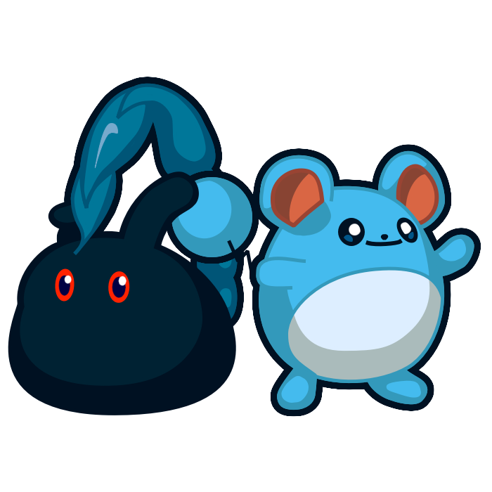
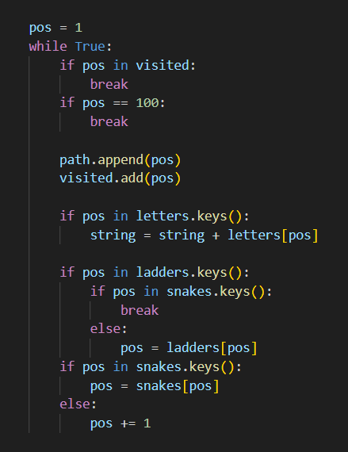
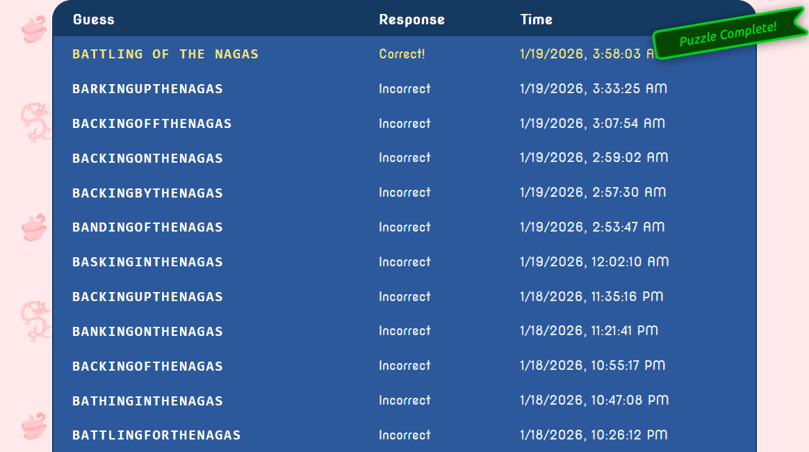
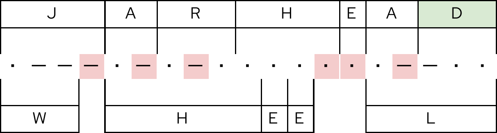
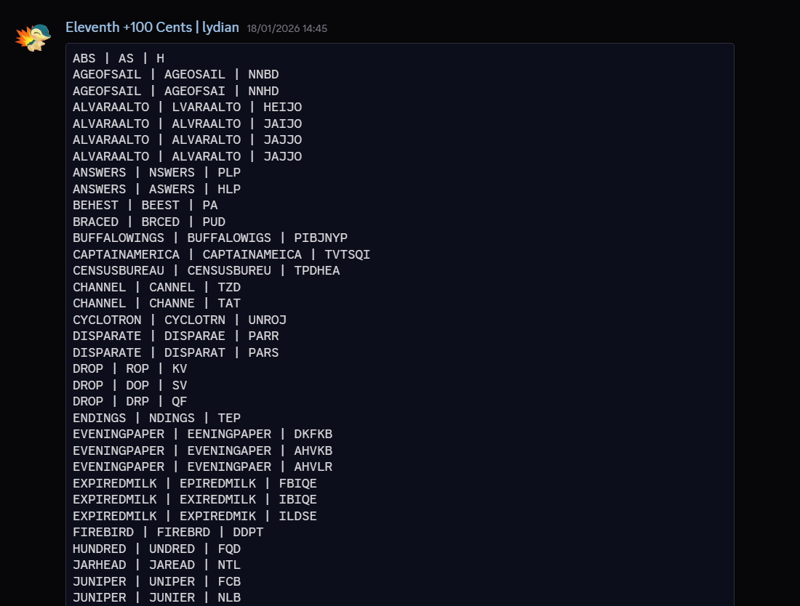

Published on January 30th, 2026

# Solving MIT Mystery Hunt (2026)

This post contains unmarked spoilers for MIT Mystery Hunt 2026.

Everyone knows the MIT Mystery Hunt is the final boss of puzzlehunts, and just like any good final boss, the most important part to get the ambience right is a good theme (seriously, listen to Tabuu, Cynthia or Marx's battle themes). And while I personally couldn't think of a theme that would appeal more to me than 2020's Penny Park, as a huge enthusiast of roller coasters and theme parks, I did overlook one possibility: turns out there was only one theme that I could do it for me, and Cardinality chose just the one! When we first got the cryptids theme from The Providence Bureau of Invest-Egg-Ations's Mystery Hatch — which, by the way, was a brilliant hunt! I just didn't make a post because I felt like I didn't have much to say —  I saw many theories circulating about a potential Pokémon-inspired theme for the full hunt, but I decided to keep my hopes low because you never really know with Mystery Hunt themes. But when the fated day came and the Kick-Off made it very clear that Puzzmon were inspired by a certain other monster collecting franchise I'm obsessed with, I was already jumping with joy! Of course, on top of the joy of the theme reveal, the Kick-Off also comes with the joy of "holy shit puzzles will be out in less than an hour"!

Not to get ahead of myself though, I should probably mention that this year I joined the Exotic Creatures of r/PictureGame to hunt, and it was a blast hunting with them! The relatively smaller nature of the team make me feel like I got to see a lot more of the hunt than I got to in prior years on larger teams, although I will also attribute that to my solving skills improving since the last Mystery Hunt I did, and getting to know everyone and hang out before hunt made solving together all the more seamless and fun! I'm looking forward to one day have the chance to participate in Mystery Hunt in person, but the weakness of our currency, earning very little for undergrad research scholarships, and being honestly a bit scared of what the US is doing to people that look like me made hunting in-person this year an impossibility. But I'm hopeful one day the day will come that I can go and meet all of my online friends in-person!

Another thing that I do think I should point out though, is that I ended up having a bit of a cold right during Mystery Hunt weekend, to which you might say "but don't you live in Brazil? Isn't it like 35 °C over there?" to which I'll answer "Yes but I traveled for my summer break and I must've caught it in the airplane on the way back '^^". Thankfully it didn't impact things too much, but I did end up being a bit more scatterbrained than usual and having to sleep like 10 hours to feel more rested instead of my usual 8, which I know, that's a lot of sleep, but I've always needed a lot not to wake up a zombie the next day, so I did really prioritize sleeping, especially with my cold, which I think was the right move, but it did take away more Mystery Hunting hours than I was expecting!

That all aside, let's talk about some puzzles I wanna shout out or that we've had interesting experiences on:

## [Aviaria](https://puzzmon.world/rounds/aviaria)

Aviaria was the first round of the hunt, and I was already a bit surprised to see a deviation from a common puzzlehunt standard, the capstone puzzles here did not use feeders as answers, but rather Puzzmon data. On top of the MonQuest and the unique unlocking system chosen here, it was a lot to take in!

<h3><a href="https://puzzmon.world/puzzles/replacements">Replacements</a></h3>

This was the first puzzle I started working on, with phenomist and Sam. I worked on one or two of the Ken Ken and then drifted off leaving one of them with the final step which wasn't parallelizeable. But I still wanted to mention this because I thought it was such an elegant execution! The Ken Ken on the Tech being constructed with two alternate solutions, and the final extraction of `BRACED` playing perfectly with the gimmick of the puzzle, just felt absurdly satisfying, and set a very good first impression for the hunt to come!

<h3><a href="https://puzzmon.world/puzzles/bird_nation">Bird Nation</a></h3>

Of course being on the team of geography fiends that is EC, it didn't take long for quatrevingtneuf to go "hey these kinda look like country flags" and we solved it pretty quickly! I think it was a really elegant introduction to capstones to show us how we can use the Puzzmon data to solve these kinds of puzzles. Of course, I did suspect these answers would be used at a later point, because surely <code>NFL FANS</code> had to feed into something! But it would be a while until I'd find that out!

## [Bubble Cove](https://puzzmon.world/rounds/bubble_cove)

It didn't take long for us to unlock a new round, before solving the Bird Nation capstone, but I decided to organize my post by round instead of chronologically, as I think things end up more organized this way! This was the round that I most interacted with MonQuest, and I tried to Find Burnham's Marbles, until I realized that the fishes' hitboxes were way more unforgiving than I was expecting and someone would probably outgamer me on that one. And it was solved by someone else immediately after I gave up, so yeah, my theory was right!

<h3><a href="https://puzzmon.world/puzzles/crossloop">Crossloop</a></h3>

I wanted to talk about this puzzle because while it's not absurdly groundbreaking, it is such a neat idea and it's executed so well! The concept of combining a Simple Loop with a Crossword seems so obvious in hindsight (and maybe it's been done before, but this is the first time I see it, at least) that it just felt nice to solve. This is the kind of puzzle that I'll take away from this hunt as being a great example of a beginner-friendly puzzle to introduce people to the hobby with! Also I will say, I kept breaking the Simple Loop when trying to solve it, until someone else probably got fed up with my slowness, or more likely didn't know I was already working on it (which like, it shouldn't take more than 30 seconds tops anyway, so fair!) and solved it first, and only after we were done with the puzzle, I realized I had mistranscribed one pair of rotationally symmetric squares of the grid into puzzlink, woops!

<h3><a href="https://puzzmon.world/puzzles/bringing_up_baby_shark">Bringing Up Baby Shark</a></h3>

Our team noticed the types of shark inspirations on the fish very quickly, but it took us a little bit more to see the shark phrases being suggested by the descriptions. I pointed out very early on that these descriptions were probably useful for this capstone as they weren't "red herring" descriptions but just "herring" this time, but still we kinda didn't really see the shark phrases for a few minutes and thought the descriptions were just cluing the types of sharks as well. In the meantime before we got the "shark phrases" aha though, I was googling frenetically about Baby Shark and trying to look if there were any variants of it out there with the clued sharks or something of that nature, but thankfully that wasn't actually how the puzzle worked...

## [Old Bark Town](https://puzzmon.world/rounds/old_bark_town)

Immediately when we unlocked this round (alongside Kitty City, cute!) I had that "neuron activation" meme thing going on about New Bark Town being a town in Pokémon, so definitely this round's capstone will involve Pokémon, right, right?

<h3><a href="https://puzzmon.world/puzzles/balancing_act">Balancing Act</a></h3>

This is a puzzle we began working on, but kinda slowed down a bit on, given the path of least resistance was elsewhere, and came back to it later on Saturday when the path of least resistance snaked its way back here again. I enjoyed working on the clues and figuring out exactly how to piece together a part of the puzzle as soon as I saw "Roman, e.g." upon opening the puzzle! The actual connection that the letters of the answer matched the number of words in the clue and that that's how extraction worked I wasn't around for, but reading back on the solution I'm just really fascinated by the puzzle! It's such an elegant way to realize the idea! And it makes me appreciate it much more than when I first saw the diagram at the bottom and thought that was the extraction!

<h3><a href="https://puzzmon.world/puzzles/central_precinct_and_lockup">Central Precinct & Lookup</a></h3>

As an enjoyer of cryptics despite being horrendously bad at them, I did try to stare at this puzzle for a bit, but then thought my efforts were probably best spent elsewhere (by which I mean staring elsewhere, not necessarily solving elsewhere). That said, I do still want to shout out this puzzle here, because the construction seems so unbelievably tight to make the center work. And the mechanics of extra letters and extra words just working together to make the final step happen is just really awesome! Even if most of this puzzle I didn't experience first-hand, it's still one of the most impressive on the hunt for me!

<h3><a href="https://puzzmon.world/puzzles/three_dog_night">Three Dog Night</a></h3>

Me upon seeing this puzzle's title: "Oh my theory was right, three is the number of starter Pokémon that you can choose in New Bark Town, this is totally a Pokémon capstone!" (It was not a Pokémon capstone.) When I actually opened the puzzle and our sheet on it, my teammates had already identified the Blues' Clues and Bluey connections. And we were for the longest time trying to figure out who the third dog was. Paw Patrol was suggested at some point, and it seemed promising that characters had associated numbers, but things just didn't fit. After a long time, some brought up Huckleberry Hound and we managed to get the puzzle solved. I don't feel particularly bad for not being the one to have that aha because I did not know this guy's name in Portuguese, let alone English. I do appreciate though how this puzzle features three different blue dogs from three very different generations (it definitely reminded me how much I used to watch Blue's Clues as a kid!), I think that's kinda neat even if the three-part approach to the puzzle didn't feel as cohesive to me mechanically.

## [Kitty City](https://puzzmon.world/rounds/kitty_city)

<h3><a href="https://puzzmon.world/puzzles/night_circus">Night Circus</a></h3>

I feel really bad for not being able to progress much on this puzzle during hunt. When we opened this puzzle someone had left a note in the Sheet theorizing that each line represented one planet, and that made sense with the theming, and the fact that there were eight of them. The Pokémon fan that I am I got ♂ for Mars immediately, and someone got Saturn shortly after. So everything so far seemed to indicate that these were the 8 planets, but we struggled to get the other symbols to fit... I went to bed and it was solved the next day, but as someone with a special interest in minor planets I was deeply disappointed to find out that I didn't even consider them, when I knew they had unique symbols as well! Alas! I can't really blame the puzzle, I really like it, in fact, but my understanding is that there's no reason why there are exactly 8 examples, and I think choosing a different number would've helped us avoid a red herring at least! Also, since Toutatis has appeared on this puzzle, I need to shout out another one of my special interests and say that it looks like <a href="https://rcdb.com/16327.htm">a really fun roller coaster</a>, and I need to visit Parc Astérix immediately.

<h3><a href="https://puzzmon.world/puzzles/watchtower">Watchtower</a></h3>

Right after Kickoff we got these very puzzle-shaped nametags, so we began solving even before the hunt would start at 13:05 TIMEMIT. Someone originally proposed <code>D.* H.*</code> initials for <code>DUGONG HUG</code>, <code>DOCTOR HAMMER</code>, <code>DRINK HEAVEN</code>, etc, but eventually we realized that <code>M.* H.*</code> and, later, <code>M.{6} H.{5}</code> made a lot more sense! Unfortunately we had no clue how to extract because we didn't notice the stars changed position, so this ended up being our first hint, oops!

<h3><a href="https://puzzmon.world/puzzles/nine_lives">Nine Lives</a></h3>

This capstone actually took us a while, we only solved it on Sunday. I don't know exactly how my teammates interpreted the puzzle, i,e, if they fell into the same rabbit hole I did, but me personally I thought the patterns on the cats were the responses they'd give to all other 18 questions from the other cats, not the responses given to their own questions, and thus, that there would be some way to order the cats to be able to figure out the answers to their twenty questions. So for instance, the first two "'yes' or 'no'"s on the pattern of the first cat, would correspond to the second cat's questions, the third and fourth "'yes' or 'no'"s to the third cat's, and so on... This led us trying to associate the cats from their drawings and names for things with dates that we could order, e.g. when the first episode of Garfield came out... Which obviously didn't really work... Eventually the puzzle got solved while I was asleep. It's always a bit frustrating to find out that a puzzle you were stuck on was leagues more intuitive and logical than whatever kind of mental gymnastics you were doing to try to make it work, hahah! But the puzzle is great, this is one of the many cases where I take full responsibility for being stupid! Although it is just a bit funny that the mathematical coincidence of 9 lives and 20 questions divided in two sets of 2 results in the other possible interpretation I had adding up. The solution to not have that problem while keeping the 9 lives and the 20 questions would have been to have 20 puzzmon instead of 10, each with one question instead of two, but I don't think anyone would've liked that option!

## [Elder Drifts](https://puzzmon.world/rounds/elder_drifts)

<h3><a href="https://puzzmon.world/puzzles/shapes">Shapes</a></h3>

This puzzle, and most of Elder Drifts, for that matter, was solved while I was asleep, but I need to shout it out because it's actually <i>so</i> funny and such a brilliant idea. The mechanical connection between the puzzle and the TikTok it's referencing legit never fails to make me laugh!

## [The Brights](https://puzzmon.world/rounds/the_brights)

<h3><a href="https://puzzmon.world/puzzles/lights_down_mode">Lights Down Mode</a></h3>

I was awake while this was getting solved, but I spent most of my awake hours on Saturday solving another puzzle I'll talk about eventually, so I missed this capstone, still wanna talk about it though... Darkrari is a really fun genre, and an even better name. I've always thought the concept of puzzles that display differently for different people is a rather underexplored concept, so it was cool to see it used in a capstone in such a thematic way, even!

## [Royal Groves](https://puzzmon.world/rounds/royal_groves)

<h3><a href="https://puzzmon.world/puzzles/rock_on">Rock On</a></h3>

I saw a teammate working on this puzzle send an image they'd gotten from one of those browser spectrogram sites on our voice chat's text chat asking for if we saw anything on a very fuzzy image (I didn't see anything, at least), so I offered to use FL Studio to get better images of what was going on and we were able to read the extract from the puzzle! It's a pretty standard fair ISIS puzzle and I like the thematic link to the Green Building, but I just wanted to use this as an excuse to say I like puzzles where I get to open my DAW for!

<h3><a href="https://puzzmon.world/puzzles/filial_pie_tree">Filial Pie Tree</a></h3>

This puzzle got solved while I was asleep from Saturday to Sunday, but I need to talk about it, using Puzzmon evolution and category made me really appreciate the mechanical and thematic tie-in to Pokémon more than other rounds, and the connection to Pokémon that have numbers in other languages did not go unnoticed (e.g. Articuno, Zapdos and Moltres; Deino, Zweilous, Hydreigon; as also indicated by the Author's Notes)! It's just a really cute puzzle, I'm a fan!

## [Eland Islands](https://puzzmon.world/rounds/eland_islands)

<h3><a href="https://puzzmon.world/puzzles/keep_going">Keep Going!</a></h3>

Also didn't solve this one, but I wanted to talk about it, I like the concept of the puzzle a lot, being given incremental steps to figure out a ciphered alphabet is a lot more interesting than it originally seems from just this description, but the main reason I wanted to talk about it is that I'm glad that the authors didn't decide it was a problem from the answer to be kinda guessable. I think obviously this is a bit bad on metas, especially ones that unlock early as used to be tradition for Mystery Hunt, obviously bypassing a whole round is cool for the split moment you do it, but be honest, are you really going back to postsolve it after hunt and managing to organize your at least 30+ person MITMH team to go alongside you? In that sense it can be a bit of a feel-bad for the team bypassing the round too. And in another way, bypassing a meta or capstone of any kind can be a bit of a bummer since they can be the most significant puzzles in a hunt, and them feeling challenging and rewarding is really important for the feel of the hunt, at least to me. But on a feeder, I actually think it's fun to open that door to the answer being guessable, as far as I know our team wasn't one of the ones that cheesed it, but I think it's gotta be such a fun feeling to just have that happen to you, that I'm glad it was kept as is, and ultimately having one feeder have a bit of a chance to be bypassed isn't enough of a dent on the competitive integrity of the hunt enough (or at all) to outweigh the thrill that the few teams that got to bypass it would have, in my opinion!

## [Serpentine Hills](https://puzzmon.world/rounds/serpentine_hills)

<h3><a href="https://puzzmon.world/puzzles/australian_caduceus">Australian Caduceus</a></h3>

It's sunday, the coin has been found, this is the final capstone we need to solve to be able to have the midhunt runaround before HQ closes. While some progress has been done, we're ultimately kind of missing more feeder solves to get there, and the logic of where to place the ladders hasn't been figured out, so I hop in and decide to code something. Before that though, phenomist had used a solver to generate all possible orientations on how to fill the rectangles on the square grid, so I used that output to go through every possibility given the snake positions that we knew, and see which ones worked. In the meantime that we were solving, someone logicking it out manually landed on a configuration which matched the exact one my code was outputting! So far so good, but there was a small problem, while other people working on the puzzle knew that one of the snakes's position wasn't fixed, broken telephone and potentially subpar notation on our sheet and Discord meant that I erroneously thought the snake positions were finalized, which they weren't. There are good news and bad news about this. The good news is that, thankfully, the snake position that I assumed we were certain of, ended up actually being the one that was correct for the puzzle by sheer coincidence! The bad news is that, unfortunately, I made a mistake on my code, see if you can spot it:
 

 

The mistake here is that this if should've been an elif, as is this means that whenever the code goes up a ladder, it also advances one extra square. And this means that instead of extracting <code>BA???ING??THENAGAS</code> like it should've, it was extracting <code>BA??ING??THENAGAS</code> instead, which was also a valid extract if the code were correct and Ttattell were in a different position, as would be <code>BA????ING??THENAGAS</code>. But of course, I didn't know any of this at the time, so I just assumed it was always <code>BA??ING??THENAGAS</code>, and I don't think anyone was around to tell me that that wasn't always true, so we kept trying to WoF until we got rate limited and kept guessing as much as the puzzle would let us, until it was too late to do the midhunt runaround anyway, at which point I went to bed and the puzzle was solved overnight with actually correct information, and an extra feeder:
 

(aside from BATTLING FOR THE NAGAS which I also included here, we had a bunch of guesses before we got to BA.{2,4}ING..THENAGAS)
 

It's especially funny to me that we had <code>BATTLING FOR THE NAGAS</code> before I did my thing and assumed that the number of blanks between "ING" and "THE NAGAS" was always 2... Yikes! I think this situation ended up being frustrating for some as our WoFing abilities plus a bit of miscommunication maybe were clearly not enough, and this meant missing the midhunt runaround, and I certainly am disappointed in the bug of my code that I only realized after the hunt was over, but still I find this situation a thousand times more funny than frustrating, the thrill of waiting 15 minutes with the whole chat trying to come up with increasingly worse puns as our better ones kept getting rejected, the extreme confidence in everyone going "this has to be it, there's no way!" every time and then it not, in fact, it! I don't know, these kinds of moments are some of the most memorable in puzzlehunts for me!

## [Kingdom of the Puzzmon](https://puzzmon.world/)

We only got the metas here on Sunday, we had them unlocked for a while, but I don't think people really touched them until we had all of them, by that point hints became available on these right was we had knocked down a few, and we were kinda worried we wouldn't finish (we didn't! but it was pretty close I think) so we just spammed hints on these when we were stuck! "Procrastinating" the round all for Sunday did mean that I got to watch all of these falling in a row and even contribute to most of them, which felt really really nice! Metas are always special to me, and I think for most puzzlers, because they really embody, at least to me, what differentiates a puzzlehunt from other kinds of puzzles and what makes this type of event so special to me, the concept of all your answers, and by proxy, your work coming together to advance the hunt more globally, it's fun! So solving a meta is always a thrill, and getting to do a boss rush of metas, even more so.

In general though, needless to say that this round was very fun! The final meta-matching extravaganza was a brilliant way to finish off the Kingdom, but I will say I think the general theme of the metas ended up feeling a bit incohesive? disconnected? I don't know if that makes much sense, but unlike the Kingdom capstones and the Dimension metas that all felt pretty aligned with their Rounds' concepts, since these didn't really have them, they didn't really feel particularly tied to the hunt's concept. Like, they felt a bit like metas that could've showed up in any other hunt and I wouldn't bat an eye, if that makes sense? To be fair, I don't really know how you'd fix that issue either? Maybe having 9 metas one for each kingdom, and have them use answers from the other kingdoms with the flavor of like, the Puzzmon working together to solve problems and get over their differences? I'm not really sure. I just think something like that would've made the metas feel a bit more grounded in the hunt in terms of flavor, but by no means were they bad! This is ultimately a small nitpick as someone that really appreciates mechanical and flavor integration!

<h3><a href="https://puzzmon.world/puzzles/name_that_tune">Name That Tune</a></h3>

We probably struggled a bit more than we should have with this one, we had to have a hint tell us to look for solfège substrings in the answers, and we had to have <i>another</i> hint to tell us that A-J ordering was not correct, at the time we had a number of answers where it seemed possible it would go like that. Eventually though, we landed on the right place, and I recorded the notes we had on FL Studio to see if people could identify the melody, with a note wrong and a few missing though, phenomist identified MORNING MOOD, whose melody I do recognize but had no idea had a name!

<h3><a href="https://puzzmon.world/puzzles/let_her_cookbook">Let Her Cook(book)!</a></h3>

Having never heard of the Cookbook being referenced on the puzzle, I was desperately trying to get this puzzle to be about Asmoranomardicadaistinaculdacar and The Underworld Cookbook, unfortunately, I got Flusterstormed and I didn't have enough mana to pay for it, so my idea got countered.

<h3><a href="https://puzzmon.world/puzzles/mixed_messaging">Mixed Messaging</a></h3>

This puzzle was frustratingly funny for us, because instead of realizing the much more obvious connection that <code>PIONEERED</code> in morse is <code>LOAD</code> in binary, we realized that if you morse PIONEERED and remove one morse character for every letter (matching the "something's still getting dropped in each message" part of the flavor text) except the last one, and respace accordingly, you get LOAD. So for a long time we tried to make that mechanic work, and it was kind of promising at points, there were some other pairs among our feeders that had this mechanic work, as we'd found with coding! Sam wrote some code and shared the output, but had to leave without leaving his source code behind, so I ended up reconstructing it myself so we could rerun it with more answers (and right as I finished doing so he came back and sent me his code, lmao). And we did find some promising matches! For example <code>JARHEAD</code> and <code>WHEEL</code>, and I proposed that 4 = 2 meant that the 4th letter of the longer word was equal to the 2nd letter of the shorter word, acting as an ordering and we'd extract the letter that didn't need to be reduced, for example:
 

 

I'm still in absolute disbelief that this kind of worked, it was definitely the craziest red herring I've ever fallen into while hunting, because as soon as I saw that <code>JARHEAD</code> → <code>WHEEL</code> connection, I was so adamantly convinced that it had to be right, that it being something else didn't even cross my mind at all. And we just barely had enough answers unresolved at that point, that it seemed possible to explain why we'd only found a two examples that matched the m = n things for the ordering step... We were still feeling really stuck though, so we sent a hint, and I was absolutely flabbergasted to find out that this, was not, in fact, the correct mechanic, but that we did have to use Morse still. Immediately we collectively realized that this was actually about reading Morse as Binary, and course corrected to the right approach. It was quite challenging finding all the matches, as there ended up being two letters to remove which did massively increase the search space (at least with our brute force approach, I didn't have the brainwidth to try to be more optimal after all the hunting we had had up to that point, hahaha), and we also didn't know what got removed (if it was from the Morse word, the binary word, from both, or one of the symbols from Morse or Binary, i.e. a dot/0 or a dash/1) thankfully I posted this list with all the valid feeder morse -1 letter → binary output strings, regardless of them being words or not and msl001 was able to notice PARS being similar to PARTS, and that's how we figured out how the puzzle actually worked:
 

 

In spite of all the unnecessary work this puzzle put us through with the reddest herring I've ever seen, I still love it! It's definitely my favorite of the Kingdom metas, it's pretty elegant when it all works, and in hindsight it feels so obvious, so I'm really glad we eventually got there, thank you Cardinality for the hint, otherwise I bet we'd still be stuck on it today, at least if it were up to me.

